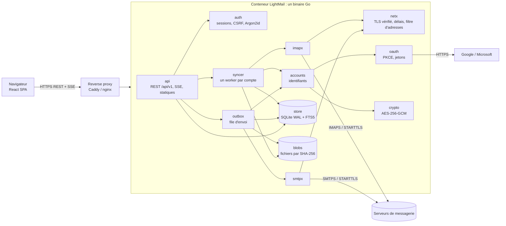

# Architecture

## Vue d'ensemble

| Paquet (`backend/internal/`) | Rôle |
|---|---|
| `config` | Variables d'environnement, variantes `*_FILE` (secrets Docker), validation |
| `logging` | Journaux JSON structurés (slog) avec masquage des clés et valeurs sensibles |
| `crypto` | Trousseau AES-256-GCM (identifiant de clé, contexte lié à la ligne et au champ, rotation) |
| `store` | SQLite (un pool écrivain, un pool lecteur), migrations embarquées, requêtes |
| `auth` | Utilisateurs locaux, Argon2id, sessions, limiteur anti force brute |
| `providers` | Préconfigurations des fournisseurs (serveurs, méthodes d'authentification, OAuth) |
| `oauth` | Flux Authorization Code + PKCE, validation du callback, jetons chiffrés, renouvellement coordonné |
| `accounts` | Résolution des identifiants (mot de passe ou jeton frais), connexions, test |
| `netx` | Politique réseau commune : TLS vérifié, CA additionnelle, délais, filtre d'adresses à la connexion |
| `imapx` / `smtpx` | Adaptateurs de protocole (go-imap v2, go-smtp) |
| `mime` | Analyse BODYSTRUCTURE, décodage, extraits, composition MIME, assainissement HTML |
| `syncer` | Moteur de synchronisation, pool de connexions, IDLE, actions sur les messages |
| `outbox` | File d'envoi persistante, annulation, nouvelles tentatives, envois ambigus, brouillons serveur |
| `search` | Opérateurs de recherche → filtres SQL/FTS5 ou critères IMAP SEARCH |
| `events` | Bus temps réel (SSE), notifications persistantes, webhook |
| `blobs` | Stockage par contenu (pièces jointes en cache, téléversements, messages sortants) |
| `backup` | Sauvegarde, vérification, restauration, verrou du répertoire de données |
| `metrics` | Métriques Prometheus sans dépendance |
| `api` | Routes REST, middlewares de sécurité, OpenAPI |
| `web` | Interface compilée, embarquée dans le binaire |

## Choix techniques

| Choix | Justification |
|---|---|
| **Go**, binaire statique sans CGO | Faible empreinte (≈ 20 Mo de RSS au repos mesurés), compilation croisée triviale amd64/arm64, image distroless de 28 Mo |
| **SQLite pur Go** (`modernc.org/sqlite`) + WAL | Aucun service externe, multi-architecture sans CGO, lectures concurrentes. Un seul écrivain sérialisé côté Go pour éviter les `SQLITE_BUSY`. |
| **FTS5** *contentless-delete* | Recherche plein texte sans dupliquer le texte (le texte reste dans `messages` / `message_bodies`) |
| **go-imap v2** | Seule bibliothèque Go maintenue avec CONDSTORE, MOVE, UIDPLUS, IDLE, ESEARCH. Elle fournit aussi un serveur en mémoire, utilisé pour les tests d'intégration. |
| **Server-Sent Events** plutôt que WebSocket | Unidirectionnel (serveur → client) suffisant, traverse les proxys HTTP, reconnexion native du navigateur |
| **React + Vite**, sans bibliothèque d'état ni de composants | 101 Ko gzip au total. Liste virtualisée maison (rendu des seules lignes visibles). |
| **bluemonday** + post-traitement + CSP + iframe sandbox | Défense en profondeur sur le HTML des emails (voir SECURITY.md) |

## Modèle de données (SQLite)

Toutes les tables métier sont rattachées à `users` (multi-utilisateur prêt, interface mono-utilisateur en v1).

- `accounts` : paramètres serveur, secrets **chiffrés** (`password_enc`, `oauth_access_enc`, `oauth_refresh_enc`), état de synchronisation, signature, préférences
- `folders` : dossier IMAP, rôle (inbox, sent, drafts, trash, junk, archive…), curseur de synchronisation (`uidvalidity`, `uidnext`, `highest_modseq`, `min_uid`, `max_uid`, `backfill_done`)
- `messages` : métadonnées et drapeaux, unicité `(folder_id, uid)`, `thread_id`, extrait, structure des parties texte
- `message_bodies` : corps téléchargés à la demande (purgés après `CACHE_TTL`)
- `attachments` : métadonnées issues de BODYSTRUCTURE, `blob_sha256` une fois téléchargée
- `messages_fts` : index plein texte (sujet, expéditeur, destinataires, corps indexés)
- `drafts`, `uploads`, `outbox`, `notifications`, `sessions`, `settings`, `oauth_states`, `blobs`, `meta`

Migrations : `backend/migrations/NNNN_*.sql`, appliquées au démarrage dans une transaction chacune et jamais modifiées une fois publiées.

## Synchronisation IMAP

Pour chaque compte, un **worker** :

1. récupère la liste des dossiers (rôles via SPECIAL-USE puis noms usuels, FR/EN) ;
2. synchronise chaque dossier actif :
   - `SELECT` (CONDSTORE si disponible). Un changement d'UIDVALIDITY vide le cache du dossier ;
   - **chemin rapide** : si UIDNEXT, EXISTS et HIGHESTMODSEQ n'ont pas bougé, rien à faire ;
   - nouveaux messages : `UID SEARCH UID n+1:*` puis FETCH par lots (enveloppe, drapeaux, BODYSTRUCTURE, quelques en-têtes) et extraits par FETCH partiel (`BODY.PEEK[x]<0.1024>`) ;
   - drapeaux : `CHANGEDSINCE` (CONDSTORE), sinon rafraîchissement complet périodique ;
   - suppressions : si `EXISTS ≠ ancien + nouveaux`, comparaison des UID serveur et locaux. go-imap v2 ne gère pas QRESYNC/VANISHED ;
3. **rattrape l'historique** (backfill) du plus récent au plus ancien par numéros de séquence, lot par lot, dans un budget de temps par passage.

Toutes les écritures sont des *upserts* sur `(folder_id, uid)`, et le curseur `max_uid` est sauvegardé après chaque lot : une interruption (redémarrage, coupure) reprend sans doublon.

**IDLE** : une connexion dédiée par compte attend sur INBOX, relancée toutes les 25 minutes. Une notification déclenche une synchronisation de l'INBOX seule, avec 1,5 s de regroupement. Le polling (`SYNC_INTERVAL`) reste actif en secours.

**Isolation et limites** : sémaphore global de synchronisations concurrentes, nombre maximal de connexions IMAP (global et par compte), pool de connexions par compte fermées après 90 s d'inactivité.

**Erreurs** : authentification refusée → arrêt des tentatives automatiques et notification. Erreur réseau → délai progressif de 30 s à 15 min avec gigue ; limitation de débit détectée (`[LIMIT]`, « too many ») → au moins 10 min. Tout délai réseau (60 s par défaut) est **définitif** pour la connexion concernée (voir TESTING.md, coupure silencieuse).

## Envoi

1. Le message MIME est construit côté serveur (Bcc jamais écrit dans les en-têtes, Message-ID sur le domaine de l'expéditeur, In-Reply-To/References pour les réponses), puis stocké dans le blob store.
2. Une entrée `outbox` est créée avec une échéance « maintenant + délai d'annulation ».
3. Un nombre borné de workers envoie : connexion, authentification, `MAIL`/`RCPT`/`DATA`.
4. Classification du résultat :
   - **5xx** → échec définitif, notification ;
   - **4xx**, ou erreur réseau **avant la fin de DATA** → nouvel essai (1 min, 5 min, 15 min, 1 h, 3 h), sans risque de doublon puisque le serveur n'a pas pu accepter un message incomplet ;
   - erreur **après le point final de DATA**, ou arrêt brutal pendant l'envoi → **ambigu** : jamais renvoyé automatiquement. LightMail cherche le Message-ID dans « Envoyés ». S'il le trouve, l'envoi est confirmé ; sinon l'utilisateur décide.
5. Après succès : drapeau `\Answered` / `$Forwarded` sur le message d'origine, copie dans « Envoyés » si le fournisseur ne le fait pas lui-même (vérification préalable par Message-ID), suppression du brouillon.

## Frontend

SPA React servie par le backend, avec routage par fragment (`#/…`). Elle dialogue uniquement avec l'API (`fetch` + jeton CSRF) et le flux SSE. Le HTML des emails est affiché dans une `<iframe sandbox>` chargée depuis un endpoint dédié (`/body.html`), jamais injecté dans le document principal. Les fragments cités dans les réponses passent par un assainissement serveur sans `<style>`, puis par un nettoyage client.

Un client de bureau pourrait réutiliser l'API (elle est versionnée et documentée en OpenAPI) ou embarquer le binaire avec une WebView.
